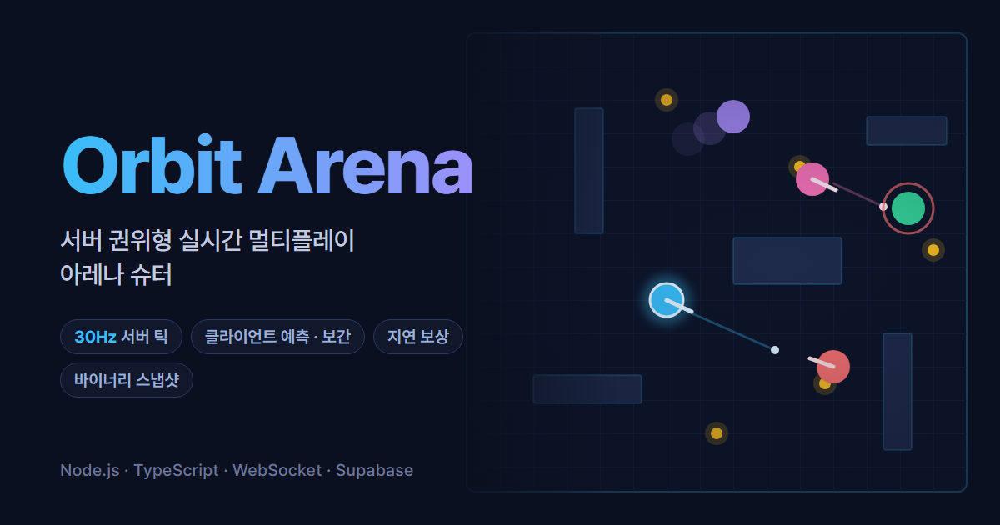
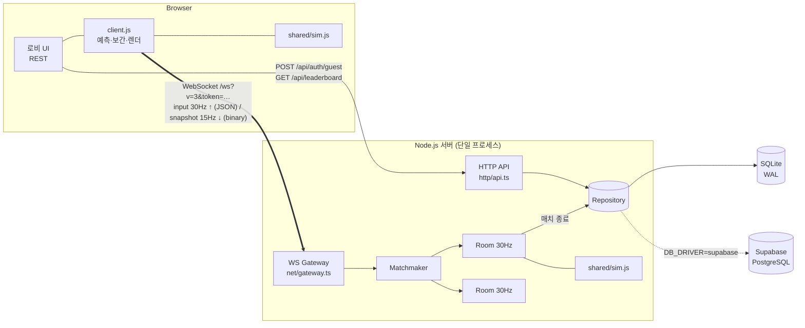
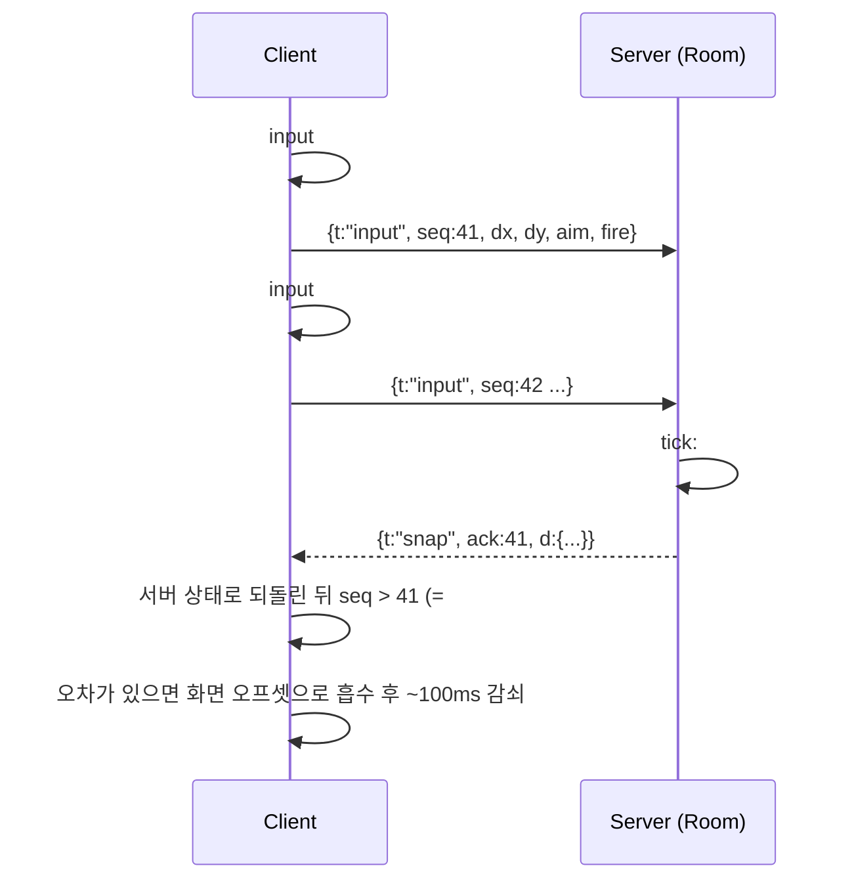
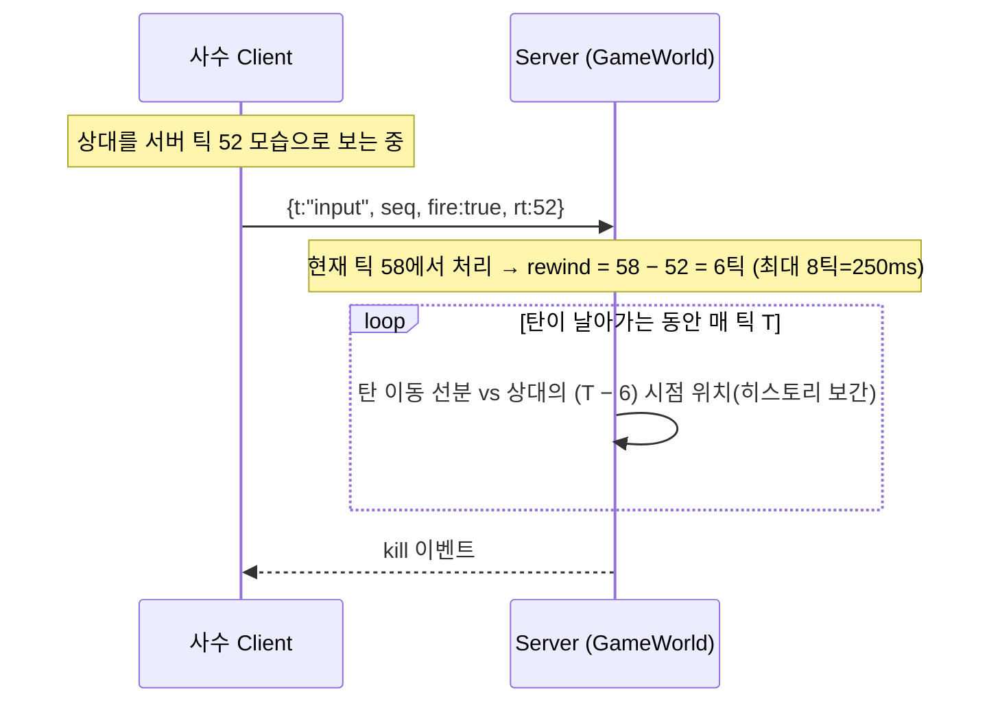

# Orbit Arena — 실시간 멀티플레이 게임 서버

> **서버 권위형(authoritative) 실시간 게임 웹 서버** 포트폴리오
> Node.js 24 · TypeScript · WebSocket · SQLite / Supabase(PostgreSQL)



브라우저에서 바로 플레이할 수 있는 탑다운 아레나 슈터입니다. 클라이언트는 **입력만** 보내고, 이동·충돌·피격·점수는 모두 서버가 계산합니다.
서버와 클라이언트가 **같은 시뮬레이션 코드(`shared/sim.js`)를 공유**하기 때문에, 클라이언트 예측 결과가 서버 결과와 정확히 같습니다.

```
WASD 이동 · 마우스 조준 · 클릭 사격 · Space 대시 · M 음소거 · Esc 나가기
```

---

## 핵심 구현 포인트

| 영역 | 내용 |
|---|---|
| **게임 루프** | 30Hz 고정 타임스텝 + 누산기(accumulator). `setTimeout` 지터가 있어도 장기적으로 정확한 틱레이트를 유지하고, 밀린 틱은 최대 5개까지만 따라잡아 *spiral of death*를 막음 |
| **넷코드** | 클라이언트 예측(prediction) → 서버 ack 기반 보정(reconciliation) → 오차를 지수 감쇠로 부드럽게 흡수. 다른 플레이어는 서버 틱 시계 기준 110ms 과거를 **보간(interpolation)** |
| **결정적 공유 시뮬레이션** | `shared/sim.js`를 서버(TS import)와 브라우저(ES module)가 그대로 사용. 테스트로 *서버 결과 == 클라이언트 예측* **완전 일치**를 검증 |
| **계층 분리 · 리플레이** | `GameWorld`(순수 규칙, I/O 없음) ↔ `Room`(세션·루프·네트워크·영속화) 분리. 룸마다 **시드 RNG**를 써서 *같은 시드 + 같은 입력 로그 → 같은 상태 해시*를 테스트로 보장. 크래시 로그에 시드·틱이 남아 재현 가능 |
| **지연 보상** | 입력에 "화면에 보이던 서버 틱(rt)"을 실어 보내고, 서버는 위치 히스토리 링버퍼로 **그 시점까지 되감아** 탄 판정(최대 250ms, 조작 방지 클램프). 아래 *지연 보상* 절 참고 |
| **연속 충돌 검사** | 탄환은 틱당 ~27px 이동하므로 끝점 검사로는 가장자리를 스치는 탄이 빠져나감(터널링). 이동 **선분 vs 원/사각형(Liang–Barsky)** 교차로 첫 충돌 대상을 판정. 같은 함수로 봇 시야(LoS) 판정 |
| **치트 방지** | 입력 값 검증·clamp, seq 역순/중복 거부(리플레이 방지), **틱당 입력 예산(1.05/tick)** 으로 입력을 몰아 보내는 스피드핵 차단, 사격 쿨다운은 서버에서만 판정 |
| **매치메이킹** | 대기열 → 풀방 즉시 시작 / 대기 시간 초과 시 **봇 채움** / 진행 중 매치 **난입(late join)** 시 봇 자리를 사람에게 양보 |
| **세션 관리** | HTTP Upgrade 단계에서 토큰·**프로토콜 버전** 검증(미인증 401, 구버전 클라이언트 426 → 새로고침 안내), 중복 접속 시 이전 연결 4001 종료, ping/pong 하트비트로 half-open 연결 정리 |
| **재접속** | 연결이 끊겨도 10초간 자리 유지 → 새로고침해도 **같은 매치로 복귀**(점수·위치 유지), 클라이언트는 지수 백오프로 재연결 |
| **백프레셔** | 소켓 송신 버퍼가 128KB를 넘으면 해당 클라이언트 스냅샷을 건너뜀(느린 소비자가 서버 메모리를 잡아먹지 않도록) |
| **바이너리 스냅샷** | 스냅샷은 고정 레이아웃 바이너리 프레임(`shared/codec.js`, 서버·브라우저 공용). 거의 안 바뀌는 오브 목록은 **연결별로 마지막에 보낸 버전과 다를 때만** 싣는 델타. 공통 본문은 1회만 인코딩하고 플레이어별로 `ack` 4바이트만 덮어씀. JSON 대비 **하행 대역폭 −60%** |
| **영속화** | Repository 인터페이스로 **SQLite ↔ Supabase** 교체. 매치 결과 + 누적 스탯 + 레이팅 갱신을 **하나의 트랜잭션**으로 처리. 일시 장애는 **지수 백오프 재시도**. 저장은 matchId 기준 **멱등**(커밋 후 응답이 유실돼도 재시도가 이중 반영 없이 저장된 결과를 돌려받음). 그래도 실패하면 게임은 계속 진행 |
| **레이팅** | 다인전 Elo(모든 참가자 쌍을 1:1로 보고 평균). 봇은 레이팅 계산에서 제외(봇 파밍 방지), 중도 이탈도 기록(패배 회피 방지) |
| **장애 격리** | 틱 처리 중 예외는 그 룸만 `error`로 종료(결과 전송·저장)하고 다른 매치는 계속. WS 메시지 핸들러 예외도 메시지 단위로 격리. 잘못된 설정은 **기동 시점에 실패**(운영에서 기본/짧은 시크릿 거부) |
| **운영** | 구조화 JSON 로그, Prometheus `/metrics`(틱 p50/p99, 드롭된 스냅샷, DB 오류 등), `/health`, Graceful shutdown 시 진행 중 매치 결과를 저장한 뒤 종료 |
| **효과음 · 에셋** | 효과음은 오디오 파일 없이 **Web Audio API로 실시간 합성**(`public/sfx.js`). 다른 플레이어 소리는 내 위치 기준 **거리 감쇠 + 좌우 패닝**, 난전에서 같은 소리는 최소 간격으로 솎아 내고 컴프레서로 클리핑 방지. 파비콘(SVG)·OG 이미지·iOS 아이콘은 원본 HTML/SVG에서 헤드리스 브라우저로 렌더링 |
| **의존성 최소화** | 런타임 의존성은 `ws`와(선택) `@supabase/supabase-js` 뿐. 웹 프레임워크·ORM·빌드 단계 없음 (Node 24 타입 스트리핑으로 `.ts` 직접 실행, `node:sqlite` 내장 모듈 사용) |

---

## 아키텍처



### 한 틱에서 일어나는 일 (`Room` → `GameWorld`)

1. `Room`: 좌석별 `InputBuffer`에서 **입력 예산만큼** 꺼냄 (봇은 `BotBrain`이 입력을 만들어 같은 버퍼로)
2. `GameWorld.step(inputs)`: `sim.stepMovement()` 이동·사격 (순수 함수, 네트워크/DB 모름)
3. 탄환 스윕 충돌(벽/플레이어 중 가장 먼저 닿는 대상) → 피격·사망·킬 점수
4. 오브 획득·재생성, 리스폰 → `Room`: 재접속 유예 만료 처리
5. 2틱마다 스냅샷 브로드캐스트 (`ack` = 그 플레이어의 마지막 처리 입력 seq)
6. 시간이 다 되면 순위 계산(`ranking.ts`) → DB 트랜잭션(재시도) → `match_end` 전송

### 클라이언트 예측 & 보정 흐름



### 지연 보상 (lag compensation)

다른 플레이어는 사수 화면에서 **과거 모습**입니다. 보간 지연 110ms에 네트워크 지연이 더해집니다. 보상이 없으면 화면에서 정확히 조준해도 서버에서는 상대가 이미 이동한 뒤라 빗나갑니다.



- **화면 기준 판정:** 클라이언트는 입력마다 지금 화면에 그리는 서버 틱 `rt`(소수)를 보냅니다.
  - 서버는 틱마다 위치를 링버퍼에 기록하고, 그 사수가 쏜 탄을 `현재 틱 − rewind` 시점 위치로 판정합니다. 위치는 두 기록 사이를 선형 보간해, 클라이언트가 그린 위치와 같습니다.
  - 탄도 피격자도 같은 시간축에 있으므로 **"내 화면에서 맞혔으면 맞는다"**가 성립합니다.
- **조작 방지:** `rt`는 클라이언트가 보내는 값이라 조작될 수 있습니다.
  - 되감기는 `[0, LAG_COMP_MAX_TICKS]`(250ms)로 제한하고, 미래 시점은 0으로 처리합니다.
  - 지금 죽어 있는 대상은 과거 위치로도 맞지 않고, 사망·리스폰 경계 구간은 판정하지 않습니다.
- **트레이드오프:** 고지연 사수에게 유리한 만큼, 피격자는 "이미 엄폐했는데 맞는" 상황을 최대 250ms까지 겪습니다. 상한값이 이 균형을 정합니다.
- **결정성 유지:** 되감기 양은 탄 상태에 포함되고 상태 해시에도 들어가므로, 리플레이 테스트가 그대로 성립합니다.

게임 화면 우하단에서 **지연 시뮬레이션(0~400ms)**, **예측/보간/지연 보상 on/off**, **서버 위치 고스트 표시**를 바꿔 가며 넷코드 효과를 직접 비교할 수 있습니다.

### 효과음

| 상황 | 소리 | 비고 |
|---|---|---|
| 내 사격 | 짧은 square 스윕 + 고역 노이즈 | 서버 응답을 기다리지 않고 **예측한 쿨다운** 기준으로 즉시 재생 |
| 다른 플레이어 사격 | 더 낮고 작은 스윕 | 스냅샷에 새로 나타난 탄환 id 기준, 거리 감쇠·패닝 |
| 피격(상대 / 나) | 밴드패스 노이즈 "톡" / 저음 충격음 | 서버 이벤트 기준 |
| 처치 / 사망 | 상승 아르페지오 / 하강 톱니파 | |
| 오브 · 대시 · 리스폰 | "띵" / 바람 소리 / 상승음 | |
| 매치 시작 / 종료 | 카운트 비프 3회 / 1위면 장조, 아니면 단조 화음 | |

- 브라우저 자동재생 정책 때문에 첫 클릭·키 입력 때 `AudioContext`를 엽니다.
- 음량은 게임 화면 우하단 슬라이더, **M** 키로 음소거. 설정은 `localStorage`에 저장됩니다.

### 정적 에셋 다시 만들기

```bash
node scripts/assets/render.ts
```

`scripts/assets/og-image.html` → `public/og-image.png`(1200×630), `public/favicon.svg` → `public/apple-touch-icon.png`(180×180). Chrome/Edge를 자동으로 찾으며, 경로는 `CHROME_PATH`로 지정할 수 있습니다.

---

## 실행

요구사항: **Node.js 22.18+** (24 권장 — TS 직접 실행 + `node:sqlite` 내장)

```bash
npm install
```

```bash
npm start
```

→ http://localhost:3000 접속. 혼자 접속해도 4초 뒤 봇이 채워져 매치가 시작됩니다. 여러 브라우저 창(시크릿 창)으로 접속하면 같은 방에서 대전합니다.

```bash
npm test
```

```bash
npm run typecheck
```

### Docker

```bash
docker build -t orbit-arena .
```

```bash
docker run -p 3000:3000 -e TOKEN_SECRET="$(openssl rand -hex 32)" -v orbit-data:/app/data orbit-arena
```

이미지는 `NODE_ENV=production`으로 돌기 때문에, `TOKEN_SECRET`이 없거나 32자보다 짧으면 서버가 기동하지 않습니다(fail fast).

---

## DB: SQLite ↔ Supabase

게임 로직은 `Repository` 인터페이스(`src/db/types.ts`)에만 의존합니다. 환경변수 하나로 저장소를 바꿀 수 있습니다.

| | SQLite (기본) | Supabase |
|---|---|---|
| 용도 | 로컬 개발, 단일 인스턴스 배포 | 관리형 Postgres, 다중 서버 인스턴스 |
| 구현 | `src/db/sqlite.ts` — `node:sqlite`, WAL, `PRAGMA user_version` 마이그레이션 | `src/db/supabase.ts` — supabase-js + RPC |
| 원자성 | `BEGIN IMMEDIATE` 트랜잭션 안에서 레이팅 읽기→계산→쓰기 | Postgres 함수 `record_match()` 한 번 호출로 처리 |
| 멱등성 | 같은 matchId 면 반영 없이 저장된 결과 반환 | 동일 (`on conflict do nothing` + 저장된 `rating_delta` 반환) |
| 검증 | 계약 테스트 (인메모리) | ① PGlite(WASM Postgres)에 마이그레이션 적용 후 SQL·RLS 테스트 ② CI에서 `supabase start` 로컬 스택에 **같은 계약 테스트** |
| 보안 | 파일 접근 권한 | RLS: 공개 읽기만 허용, 쓰기는 `service_role`(서버)만 |

### Supabase 사용법

1. Supabase 프로젝트 생성 → `supabase db push` 또는 SQL Editor에서 [`supabase/migrations/`](supabase/migrations/)의 파일을 **이름 순서대로** 실행
2. 환경변수 설정 후 실행

```bash
DB_DRIVER=supabase SUPABASE_URL=https://xxxx.supabase.co SUPABASE_SERVICE_ROLE_KEY=... npm start
```

> `service_role` 키는 RLS를 우회하므로 **서버 환경변수에만** 두고 브라우저에 절대 노출하지 않습니다.
> 클라이언트는 항상 게임 서버 REST API를 거쳐 데이터를 읽습니다.

### Supabase 구현 검증

Supabase 쪽 코드는 두 단계로 자동 검증합니다.

1. **스키마·SQL 함수** — [`test/supabase-schema.test.ts`](test/supabase-schema.test.ts)
   - [PGlite](https://pglite.dev)(WASM으로 빌드한 실제 PostgreSQL)에 Supabase 기본 역할(`anon`/`authenticated`/`service_role`)과 기본 권한을 재현한 뒤, 마이그레이션을 순서대로 적용합니다.
   - 검증 항목: `record_match`의 반영·**원자성(롤백)**·**멱등성**, `player_matches` 정렬, **RLS**(익명은 읽기만, 쓰기 0행, RPC 호출 거부), 제약조건·인덱스.
   - Docker 없이 `npm test`에서 매번 돕니다.
2. **supabase-js 어댑터** — [`test/repository.test.ts`](test/repository.test.ts)
   - SQLite와 Supabase 구현에 **같은 계약 테스트**를 돌립니다.
   - CI의 `supabase` 잡이 `supabase start`(Postgres + PostgREST + Kong)로 마이그레이션을 적용하고 실제 HTTP API로 실행합니다.
   - 로컬에서는 `SUPABASE_TEST_URL`, `SUPABASE_TEST_SERVICE_ROLE_KEY`가 있을 때만 돌고, 없으면 건너뜁니다.

검증 과정에서 고친 문제:
- **재시도 이중 실패:** 커밋 후 응답이 유실되면 재시도가 PK 충돌로 계속 실패해, 레이팅 변동이 사라졌습니다. → `record_match`를 멱등하게 바꿨습니다.
- **전적 정렬 누락:** 전적 조회가 `referencedTable` 정렬을 썼는데, 이 정렬은 부모 행 순서를 바꾸지 않습니다. 그래서 `limit`이 정렬 전에 적용되었습니다. → `player_matches()` 함수로 옮겼습니다.

### 스키마

```
players        (id, nickname, rating, games, wins, kills, deaths, best_score, created_at, last_seen_at)
matches        (id, started_at, ended_at, player_count, bot_count)
match_players  (match_id, player_id, nickname, score, kills, deaths, placement, rating_delta)  PK(match_id, player_id)
```

리더보드 조회용 부분 인덱스 `(rating DESC, wins DESC, best_score DESC) WHERE games > 0`.

---

## API

### REST

| Method | Path | 설명 |
|---|---|---|
| POST | `/api/auth/guest` | `{nickname}` → 게스트 계정 + 서명 토큰 발급 (IP당 분당 5회) |
| GET | `/api/me` | 내 정보 + 최근 전적 (Bearer 토큰) |
| GET | `/api/leaderboard?limit=20` | 레이팅 순위 |
| GET | `/api/matches/recent?limit=10` | 최근 매치 |
| GET | `/api/players/:id` | 플레이어 프로필 + 전적 |
| GET | `/api/stats` | 접속자, 룸 수, 대기열, 틱 처리 시간 |
| GET | `/health` | DB 연결 포함 헬스체크 (실패 시 503) |
| GET | `/metrics` | Prometheus 포맷 |

모든 `/api/*`는 IP별 토큰 버킷 레이트 리밋이 적용됩니다.

### WebSocket `/ws?v=<PROTOCOL_VERSION>&token=…`

| 방향 | 메시지 |
|---|---|
| C→S | `queue` · `leave` · `ping{ts}` · `input{seq,dx,dy,aim,fire,dash,rt?}` |
| S→C (JSON) | `welcome` · `queued` · `match_start{you,roster,remainingTicks}` · `roster` · `match_end{results}` · `pong` · `left` · `error` |
| S→C (binary) | 스냅샷 `{ack, tick, rem, p, b, o?, ev}` — 아래 레이아웃 |

스냅샷은 리틀 엔디언 고정 레이아웃 바이너리 프레임입니다([`shared/codec.js`](shared/codec.js)).

| 구간 | 크기 | 필드 |
|---|---|---|
| 헤더 | 18B | `u8 type=1` · `u32 ack` · `u32 tick` · `u32 rem` · `u8 flags` · `u8 nP` · `u16 nB` · `u8 nEv` |
| 플레이어 × nP | 22B | `u16 eid` · `f32 x,y` · `u8 hp` · `u8 alive` · `u16 score` · `i16 aim(×2000)` · `u8 dashTicks,dashCd` · `u16 kills,deaths` |
| 탄환 × nB | 8B | `u32 id` · `i16 x,y (×16)` |
| 오브 (flags&1일 때만) | 1 + 5B × nO | `u8 nO`, 각 `u8 id` · `u16 x,y` |
| 이벤트 × nEv | 5B | `u8 kind(1 hit·2 kill·3 orb)` · `u16 a,b` |

- **좌표 정밀도:** 플레이어 좌표는 `f32`입니다. 클라이언트는 자기 위치를 이 값으로 되돌린 뒤 입력을 재적용하므로, 양자화 오차가 곧 보정 오차가 되기 때문입니다. 탄환·오브는 그리기만 하므로 고정소수점으로 충분합니다.
- **크기 (8인 매치 평균):** JSON 704B → 바이너리 322B → 오브 델타 적용 시 275B. 오브는 스냅샷의 약 13%에만 실립니다.

핸드셰이크 거부: `401` 토큰 무효/만료 · `426` 프로토콜 버전 불일치 (`/health`의 `protocolVersion`으로 원인 확인)

WS 종료 코드: `4001` 다른 곳에서 접속 · `4008` 레이트 리밋 초과 · `1001` 서버 종료

---

## 성능 측정

`scripts/loadtest.ts` — 가상 클라이언트가 게스트 로그인 → 매칭 → 30Hz 입력(이동+사격) 전송.

```bash
GUEST_RATE_PER_MIN=100000 API_RATE_PER_SEC=10000 npm start
```

```bash
node scripts/loadtest.ts 256 20
```

측정 환경: Windows 11, Node 24.15, **부하 생성기와 서버를 같은 머신에서 실행** (실제 네트워크 지연 없음)

| 동시 접속 | 룸 | 틱 처리 평균 | 틱 p99 | 틱 최대 | RTT p50 / p99 | 스냅샷 간격 p50 / p99 | 하행 대역폭 |
|---|---|---|---|---|---|---|---|
| 64 | 8 | 0.18 ms | 0.80 ms | 2.1 ms | 2.0 / 3.8 ms | 65 / 81 ms | 217 KB/s (JSON 시절 546) |
| 256 | 32 | 0.14 ms | 0.62 ms | 0.9 ms | 6.1 / 13.2 ms | 66 / 83 ms | 865 KB/s (JSON 시절 2.2 MB/s) |

- 틱 예산 33.3ms 대비 룸 하나의 틱 처리 비용은 **약 0.16ms** → 32개 룸 × 30Hz를 돌려도 CPU 한 코어의 약 15% 수준
- 스냅샷 간격 p50 ≈ 64ms로 목표 15Hz(66.7ms)를 유지
- 하행 대역폭은 클라이언트당 약 3.4KB/s입니다. 프로토콜 v2(JSON)의 8.7KB/s에서 **−61%** 줄었습니다(바이너리 스냅샷 + 오브 델타).

---

## 프로젝트 구조

```
shared/sim.js          서버·클라이언트 공용 결정적 시뮬레이션 (이동, 충돌, 스윕 판정, 상수, 프로토콜 버전)
shared/codec.js        서버·클라이언트 공용 바이너리 스냅샷 코덱
src/
  server.ts            엔트리포인트 + graceful shutdown
  app.ts               조립(composition root): 설정 → DB → 매치메이커 → HTTP/WS
  config.ts            환경변수 설정 + 기동 시 검증(fail fast)
  auth/token.ts        HMAC-SHA256 서명 토큰 (상수 시간 비교)
  net/gateway.ts       WS 업그레이드 인증, 세션, 하트비트, 레이트 리밋, 메시지 라우팅
  net/protocol.ts      클라이언트 메시지 검증
  game/world.ts        순수 게임 규칙(이동·탄환·오브·리스폰), 지연 보상 히스토리, 상태 해시 — I/O 없음
  game/room.ts         세션 계층: 좌석·재접속, 30Hz 루프, 장애 격리, 스냅샷, 결과 저장
  game/inputBuffer.ts  플레이어별 입력 파이프라인 (seq 검증, 큐 상한, 틱당 예산)
  game/ranking.ts      경쟁 순위(1224) 계산
  game/matchmaker.ts   대기열, 봇 채움, 난입, 룸 수명주기
  game/bot.ts          봇 AI (사람과 같은 입력 파이프라인 사용)
  db/                  Repository 인터페이스, SQLite·Supabase 구현, Elo 레이팅
  http/api.ts          REST API + 정적 파일 (경로 탈출 방지)
  util/                JSON 로거, 토큰 버킷, Prometheus 메트릭, 시드 RNG, 재시도
public/                브라우저 클라이언트 (Canvas, 빌드 없음), sfx.js = Web Audio 합성 효과음(오디오 파일 없음), 파비콘·OG 이미지
scripts/assets/        OG 이미지 원본 HTML + PNG 렌더러 (`node scripts/assets/render.ts`, 헤드리스 Chrome/Edge)
supabase/migrations/   Postgres 스키마, RLS, record_match()(멱등)·player_matches() 함수
supabase/config.toml   CI용 로컬 Supabase 스택 설정
test/                  단위·룸·코덱·통합(E2E)·Repository 계약·Supabase 스키마(PGlite) 테스트 — node:test
scripts/loadtest.ts    부하 테스트
.github/workflows/     CI: typecheck → test → (Supabase 로컬 스택 계약 테스트 | Docker 빌드 + /health 스모크 테스트)
```

## 테스트

```bash
npm run check   # tsc + 테스트
```

`node:test` 49개(Supabase 계약 테스트 1개는 자격 증명이 있을 때만), GitHub Actions에서 push/PR마다 실행됩니다.

- **시뮬레이션:** 결정성, 충돌, **서버==예측 일치**, 선분-원/사각형 교차(터널링 방지), 가장자리를 스치는 탄 적중
- **리플레이:** 같은 시드 + 같은 입력 로그 600틱 → **상태 해시 일치**. 이 테스트로 봇 ID가 `randomUUID()`라 결정성이 깨지던 문제를 찾아 고쳤습니다.
- **지연 보상:** 화면에서 맞힌 탄은 피격자가 이미 피했어도 적중, 오래전에 피한 대상은 빗나감, rt 조작 시 상한 클램프, 히스토리 보간, rt 검증
- **안티치트:** 입력 예산(4배 입력 공격 시 처리율 제한), seq 리플레이 거부
- **게임 흐름:** 사격→사망→리스폰, 재접속 유예, 같은 매치 재입장 시 기록 복원(+DB 중복 저장 방지)
- **장애 대응:** 틱 예외 시 룸 격리 종료, DB 일시 장애 재시도
- **영속화:** 매치 종료→DB→레이팅, 경쟁 순위, SQLite·Supabase 공통 **Repository 계약**(멱등 재시도, 전적 정렬 후 limit)
- **Supabase 스키마:** PGlite에서 실제 마이그레이션 적용, `record_match` 원자성·멱등성, RLS·권한
- **코덱:** 바이너리 왕복 정밀도, 잘린 프레임 거부, JSON 대비 크기, 오브 델타(첫 전송·변화·혼잡 후·재접속 시 재전송)
- **보안·설정:** 토큰 변조/만료, 레이트 리밋, 프로토콜 검증, 설정 검증(운영 시크릿)
- **HTTP/WS:** REST 인증, WS 401 거부, 프로토콜 버전 426 거부, 중복 접속 4001
- **E2E:** 로그인→매칭→스냅샷→종료→리더보드

---

## 한계와 다음 단계

솔직하게 남겨 둔 부분과 확장 방향입니다.

- **수평 확장**: 지금은 단일 프로세스입니다. 룸은 서로 독립적이므로 *룸 단위 샤딩*이 자연스럽습니다. 매치메이커를 Redis 대기열로 분리하고, 각 게임 서버가 룸을 맡고, 로드밸런서는 `roomId` 기반 sticky 라우팅을 하는 구조로 갈 수 있습니다. 이때 DB는 Supabase(Postgres)를 씁니다.
- **스냅샷 델타 확장**: 지금은 오브만 델타입니다. 플레이어·탄환까지 기준 스냅샷 대비 델타로 보내면 더 줄일 수 있습니다. 대신 클라이언트가 기준 스냅샷의 ack를 돌려줘야 합니다.
- **Supabase 레이팅 계산 위치**: Supabase 어댑터는 레이팅을 읽어 델타를 계산한 뒤 `record_match`에 넘깁니다. 갱신은 `rating + delta` 상대값이라 유실은 없습니다. 다만 같은 플레이어의 매치 두 개가 동시에 끝나면 기대 승률이 약간 오래된 레이팅으로 계산됩니다. Elo 계산을 SQL 함수 안(행 잠금)으로 옮기면 SQLite와 완전히 같아집니다.
- **실제 Supabase 프로젝트 E2E**: CI는 로컬 Supabase 스택으로 검증합니다. 호스팅 프로젝트(커넥션 풀러·네트워크 지연 포함)에서의 동작은 따로 확인해야 합니다.
- **계정**: 현재는 게스트 토큰만 있습니다. Supabase Auth(OAuth)를 붙이면 토큰 검증을 Supabase JWT로 교체할 수 있습니다.
