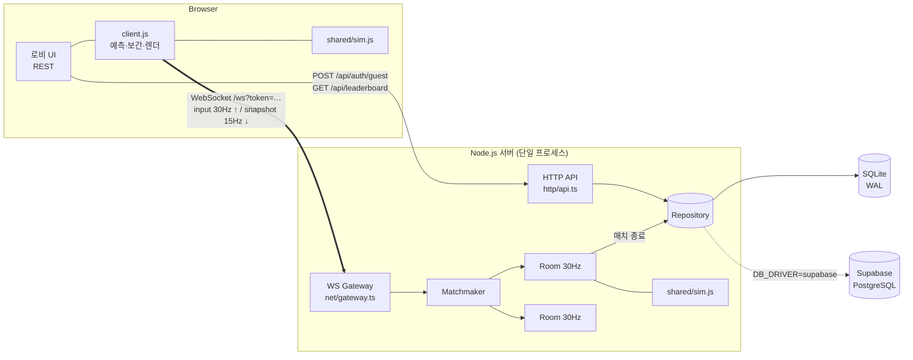
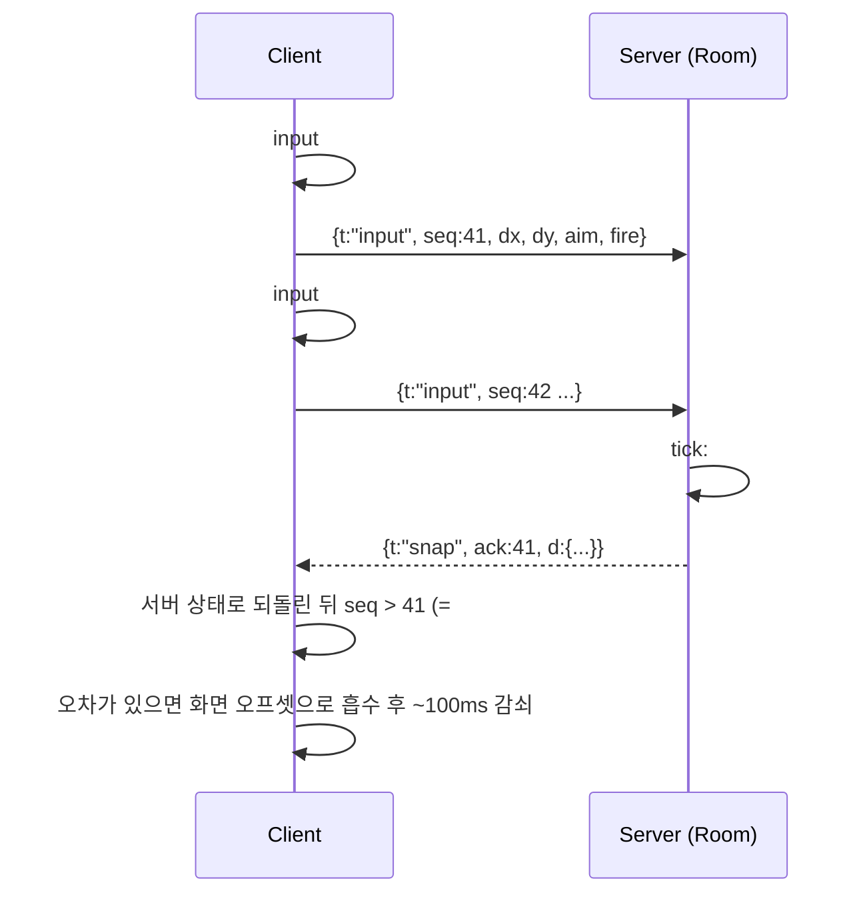

# Orbit Arena — 실시간 멀티플레이 게임 서버

> **서버 권위형(authoritative) 실시간 게임 웹 서버** 포트폴리오
> Node.js 24 · TypeScript · WebSocket · SQLite / Supabase(PostgreSQL)

브라우저에서 바로 플레이할 수 있는 탑다운 아레나 슈터입니다. 클라이언트는 **입력만** 보내고, 이동·충돌·피격·점수는 모두 서버가 계산합니다.
서버와 클라이언트가 **같은 시뮬레이션 코드(`shared/sim.js`)를 공유**하기 때문에, 클라이언트 예측 결과가 서버 결과와 정확히 같습니다.

```
WASD 이동 · 마우스 조준 · 클릭 사격 · Space 대시 · Esc 나가기
```

---

## 핵심 구현 포인트

| 영역 | 내용 |
|---|---|
| **게임 루프** | 30Hz 고정 타임스텝 + 누산기(accumulator). `setTimeout` 지터가 있어도 장기적으로 정확한 틱레이트를 유지하고, 밀린 틱은 최대 5개까지만 따라잡아 *spiral of death*를 막음 |
| **넷코드** | 클라이언트 예측(prediction) → 서버 ack 기반 보정(reconciliation) → 오차를 지수 감쇠로 부드럽게 흡수. 다른 플레이어는 서버 틱 시계 기준 110ms 과거를 **보간(interpolation)** |
| **결정적 공유 시뮬레이션** | `shared/sim.js`를 서버(TS import)와 브라우저(ES module)가 그대로 사용. 테스트로 *서버 결과 == 클라이언트 예측* **완전 일치**를 검증 |
| **치트 방지** | 입력 값 검증·clamp, seq 역순/중복 거부(리플레이 방지), **틱당 입력 예산(1.05/tick)** 으로 입력을 몰아 보내는 스피드핵 차단, 사격 쿨다운은 서버에서만 판정 |
| **매치메이킹** | 대기열 → 풀방 즉시 시작 / 대기 시간 초과 시 **봇 채움** / 진행 중 매치 **난입(late join)** 시 봇 자리를 사람에게 양보 |
| **세션 관리** | HTTP Upgrade 단계에서 토큰 검증(미인증은 핸드셰이크 전 401), 중복 접속 시 이전 연결 4001 종료, ping/pong 하트비트로 half-open 연결 정리 |
| **재접속** | 연결이 끊겨도 10초간 자리 유지 → 새로고침해도 **같은 매치로 복귀**(점수·위치 유지), 클라이언트는 지수 백오프로 재연결 |
| **백프레셔** | 소켓 송신 버퍼가 128KB를 넘으면 해당 클라이언트 스냅샷을 건너뜀(느린 소비자가 서버 메모리를 잡아먹지 않도록) |
| **직렬화 최적화** | 스냅샷 공통 본문은 1회만 `JSON.stringify`, 플레이어별로 다른 `ack`만 문자열 결합 → 룸당 O(N) |
| **영속화** | Repository 인터페이스로 **SQLite ↔ Supabase** 교체. 매치 결과 + 누적 스탯 + 레이팅 갱신을 **하나의 트랜잭션**으로 처리. DB 장애가 나도 게임은 계속 진행 |
| **레이팅** | 다인전 Elo(모든 참가자 쌍을 1:1로 보고 평균). 봇은 레이팅 계산에서 제외(봇 파밍 방지), 중도 이탈도 기록(패배 회피 방지) |
| **운영** | 구조화 JSON 로그, Prometheus `/metrics`(틱 p50/p99, 드롭된 스냅샷, DB 오류 등), `/health`, Graceful shutdown 시 진행 중 매치 결과를 저장한 뒤 종료 |
| **의존성 최소화** | 런타임 의존성은 `ws`와(선택) `@supabase/supabase-js` 뿐. 웹 프레임워크·ORM·빌드 단계 없음 (Node 24 타입 스트리핑으로 `.ts` 직접 실행, `node:sqlite` 내장 모듈 사용) |

---

## 아키텍처



### 한 틱에서 일어나는 일 (`src/game/room.ts`)

1. 플레이어별 입력 큐에서 **입력 예산만큼** 꺼내 `sim.stepMovement()` 적용 (봇도 같은 파이프라인)
2. 탄환 이동 → 장애물/플레이어 충돌 → 피격·사망·킬 점수
3. 오브 획득·재생성, 리스폰, 재접속 유예 만료 처리
4. 2틱마다 스냅샷 브로드캐스트 (`ack` = 그 플레이어의 마지막 처리 입력 seq)
5. 시간이 다 되면 순위 계산 → DB 트랜잭션 → `match_end` 전송

### 클라이언트 예측 & 보정 흐름



게임 화면 우하단에서 **지연 시뮬레이션(0~400ms)**, **예측/보간 on/off**, **서버 위치 고스트 표시**를 바꿔 가며 넷코드 효과를 직접 비교할 수 있습니다.

---

## 실행

요구사항: **Node.js 22.18+** (24 권장 — TS 직접 실행 + `node:sqlite` 내장)

```bash
npm install
```

```bash
npm start
```

→ http://localhost:3000 접속. 혼자 접속해도 4초 뒤 봇이 채워져 매치가 시작됩니다. 여러 브라우저 창(시크릿 창)으로 접속하면 같은 방에서 대전합니다.

```bash
npm test
```

```bash
npm run typecheck
```

### Docker

```bash
docker build -t orbit-arena .
```

```bash
docker run -p 3000:3000 -e TOKEN_SECRET=change-me -v orbit-data:/app/data orbit-arena
```

---

## DB: SQLite ↔ Supabase

게임 로직은 `Repository` 인터페이스(`src/db/types.ts`)에만 의존합니다. 환경변수 하나로 저장소를 바꿀 수 있습니다.

| | SQLite (기본) | Supabase |
|---|---|---|
| 용도 | 로컬 개발, 단일 인스턴스 배포 | 관리형 Postgres, 다중 서버 인스턴스 |
| 구현 | `src/db/sqlite.ts` — `node:sqlite`, WAL, `PRAGMA user_version` 마이그레이션 | `src/db/supabase.ts` — supabase-js + RPC |
| 원자성 | `BEGIN IMMEDIATE` 트랜잭션 안에서 레이팅 읽기→계산→쓰기 | Postgres 함수 `record_match()` 한 번 호출로 처리 |
| 보안 | 파일 접근 권한 | RLS: 공개 읽기만 허용, 쓰기는 `service_role`(서버)만 |

### Supabase 사용법

1. Supabase 프로젝트 생성 → SQL Editor에서 [`supabase/migrations/20261119000000_init.sql`](supabase/migrations/20261119000000_init.sql) 실행
2. 환경변수 설정 후 실행

```bash
DB_DRIVER=supabase SUPABASE_URL=https://xxxx.supabase.co SUPABASE_SERVICE_ROLE_KEY=... npm start
```

> `service_role` 키는 RLS를 우회하므로 **서버 환경변수에만** 두고 브라우저에 절대 노출하지 않습니다.
> 클라이언트는 항상 게임 서버 REST API를 거쳐 데이터를 읽습니다.

### 스키마

```
players        (id, nickname, rating, games, wins, kills, deaths, best_score, created_at, last_seen_at)
matches        (id, started_at, ended_at, player_count, bot_count)
match_players  (match_id, player_id, nickname, score, kills, deaths, placement, rating_delta)  PK(match_id, player_id)
```

리더보드 조회용 부분 인덱스 `(rating DESC, wins DESC, best_score DESC) WHERE games > 0`.

---

## API

### REST

| Method | Path | 설명 |
|---|---|---|
| POST | `/api/auth/guest` | `{nickname}` → 게스트 계정 + 서명 토큰 발급 (IP당 분당 5회) |
| GET | `/api/me` | 내 정보 + 최근 전적 (Bearer 토큰) |
| GET | `/api/leaderboard?limit=20` | 레이팅 순위 |
| GET | `/api/matches/recent?limit=10` | 최근 매치 |
| GET | `/api/players/:id` | 플레이어 프로필 + 전적 |
| GET | `/api/stats` | 접속자, 룸 수, 대기열, 틱 처리 시간 |
| GET | `/health` | DB 연결 포함 헬스체크 (실패 시 503) |
| GET | `/metrics` | Prometheus 포맷 |

모든 `/api/*`는 IP별 토큰 버킷 레이트 리밋이 적용됩니다.

### WebSocket `/ws?token=…`

| 방향 | 메시지 |
|---|---|
| C→S | `queue` · `leave` · `ping{ts}` · `input{seq,dx,dy,aim,fire,dash}` |
| S→C | `welcome` · `queued` · `match_start{you,roster,remainingTicks}` · `roster` · `snap{ack,d:{tick,rem,p,b,o,ev}}` · `match_end{results}` · `pong` · `left` · `error` |

스냅샷 `p`는 대역폭을 줄이려고 객체 대신 튜플 배열 `[eid,x,y,hp,alive,score,aim,dashTicks,dashCd,kills,deaths]`을 씁니다.

WS 종료 코드: `4001` 다른 곳에서 접속 · `4008` 레이트 리밋 초과 · `1001` 서버 종료

---

## 성능 측정

`scripts/loadtest.ts` — 가상 클라이언트가 게스트 로그인 → 매칭 → 30Hz 입력(이동+사격) 전송.

```bash
GUEST_RATE_PER_MIN=100000 API_RATE_PER_SEC=10000 npm start
```

```bash
node scripts/loadtest.ts 256 20
```

측정 환경: Windows 11, Node 24.15, **부하 생성기와 서버를 같은 머신에서 실행** (실제 네트워크 지연 없음)

| 동시 접속 | 룸 | 틱 처리 평균 | 틱 p99 | 틱 최대 | RTT p50 / p99 | 스냅샷 간격 p50 / p99 | 하행 대역폭 |
|---|---|---|---|---|---|---|---|
| 64 | 8 | 0.18 ms | 0.58 ms | 2.4 ms | 2.1 / 4.4 ms | 63 / 80 ms | 546 KB/s |
| 256 | 32 | 0.16 ms | 0.49 ms | 1.2 ms | 3.5 / 12.8 ms | 64 / 85 ms | 2.2 MB/s |

- 틱 예산 33.3ms 대비 룸 하나의 틱 처리 비용은 **약 0.16ms** → 32개 룸 × 30Hz를 돌려도 CPU 한 코어의 약 15% 수준
- 스냅샷 간격 p50 ≈ 64ms로 목표 15Hz(66.7ms)를 유지
- 하행 대역폭은 클라이언트당 약 8.7KB/s (JSON 기준)

---

## 프로젝트 구조

```
shared/sim.js          서버·클라이언트 공용 결정적 시뮬레이션 (이동, 충돌, 상수)
src/
  server.ts            엔트리포인트 + graceful shutdown
  app.ts               조립(composition root): 설정 → DB → 매치메이커 → HTTP/WS
  config.ts            환경변수 설정
  auth/token.ts        HMAC-SHA256 서명 토큰 (상수 시간 비교)
  net/gateway.ts       WS 업그레이드 인증, 세션, 하트비트, 레이트 리밋, 메시지 라우팅
  net/protocol.ts      클라이언트 메시지 검증
  game/room.ts         30Hz 권위 시뮬레이션, 스냅샷, 결과 집계
  game/matchmaker.ts   대기열, 봇 채움, 난입, 룸 수명주기
  game/bot.ts          봇 AI (사람과 같은 입력 파이프라인 사용)
  db/                  Repository 인터페이스, SQLite·Supabase 구현, Elo 레이팅
  http/api.ts          REST API + 정적 파일 (경로 탈출 방지)
  util/                JSON 로거, 토큰 버킷, Prometheus 메트릭
public/                브라우저 클라이언트 (Canvas, 빌드 없음)
supabase/migrations/   Postgres 스키마, RLS, record_match() 함수
test/                  단위·룸·통합(E2E) 테스트 — node:test
scripts/loadtest.ts    부하 테스트
```

## 테스트

`node:test` 19개: 시뮬레이션 결정성, 충돌, **서버==예측 일치**, 입력 예산(스피드핵), seq 리플레이 거부, 사격→사망→리스폰, 재접속 유예, 매치 종료→DB→레이팅, 토큰 변조/만료, 레이트 리밋, 프로토콜 검증, REST 인증, WS 401 거부, 중복 접속 4001, **E2E(로그인→매칭→스냅샷→종료→리더보드)**.

---

## 한계와 다음 단계

솔직하게 남겨 둔 부분과 확장 방향입니다.

- **수평 확장**: 지금은 단일 프로세스입니다. 룸은 서로 독립적이므로 *룸 단위 샤딩*이 자연스럽습니다. 매치메이커를 Redis 대기열로 분리하고, 각 게임 서버가 룸을 맡고, 로드밸런서는 `roomId` 기반 sticky 라우팅을 하는 구조로 갈 수 있습니다. 이때 DB는 Supabase(Postgres)를 씁니다.
- **지연 보상(lag compensation)**: 피격 판정은 현재 서버 시점 기준입니다. 플레이어별 위치 히스토리를 두고 사격 시점의 RTT/2만큼 되감아 판정하는 방식(rewind)을 추가할 수 있습니다.
- **바이너리 프로토콜**: JSON 대신 `ArrayBuffer` 고정 레이아웃과 델타 압축을 쓰면 대역폭을 크게 줄일 수 있습니다.
- **Supabase 구현 검증**: SQL 스키마와 어댑터는 작성했지만, 이 저장소의 자동 테스트는 SQLite로만 돕니다(실제 Supabase 프로젝트 필요).
- **계정**: 현재는 게스트 토큰만 있습니다. Supabase Auth(OAuth)를 붙이면 토큰 검증을 Supabase JWT로 교체할 수 있습니다.
